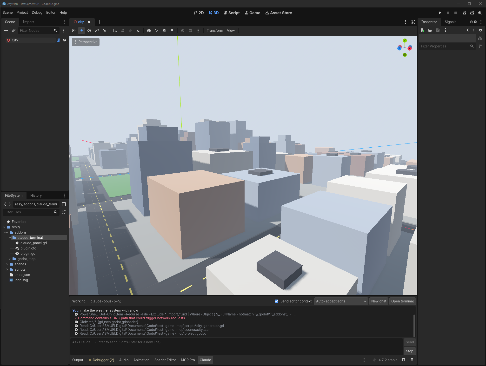

# Claude Terminal for Godot

Run [Claude Code](https://docs.claude.com/en/docs/claude-code/overview) directly inside the Godot editor, similar to the AI assistant panels in other engines.
It adds a **Claude** tab to the bottom panel: you type, Claude reads and edits your project, and you watch each step live.



- **Godot:** 4.7+ (developed and tested on 4.7.2, Windows)
- **Platforms:** Windows, macOS, Linux
- **Language:** GDScript only, no extra dependencies
- **License:** MIT

---

## Features

- **Chat panel in the editor.** Talk to Claude Code without leaving Godot. The conversation keeps its context between messages.
- **Live status.** A spinner, the current step ("Thinking…", "Running Read…", "Writing…") and a timer.
- **Streaming replies.** Claude's answer appears word by word as it is written.
- **Activity list.** Every tool call Claude makes, with its live run time and ✓/✗ when done. Subagent work is nested under its parent.
- **MCP server status.** Shows each MCP server Claude Code started (for example Godot MCP Pro) as connected or failed.
- **Editor context.** Optionally tells Claude which scene, nodes and script you have open.
- **Permission modes.** Auto-accept edits, plan only (read-only), or bypass all permissions.
- **MCP switch.** Turn MCP servers off for the panel when they clash with other Claude sessions.
- **Open terminal.** One click opens the full interactive Claude Code in a system terminal, in your project folder.
- **Token counter** for the current chat.
- **Auto refresh.** Godot rescans the file system after each reply, so new files show up right away.

## Requirements

1. **Godot 4.7 or newer.**
2. **Claude Code**, installed and logged in. Check by running `claude` in a terminal once.
   Install guide: <https://docs.claude.com/en/docs/claude-code/setup>
3. A Claude subscription (Pro or Max) or an Anthropic API key, used by Claude Code.

## Installation

### Option A: download the release (easiest)

1. Download `claude_terminal.zip` from the [latest release](../../releases/latest).
2. Unzip it into your Godot project folder. You should end up with:
   ```
   your-project/
   └── addons/
       └── claude_terminal/
           ├── plugin.cfg
           ├── plugin.gd
           └── claude_panel.gd
   ```
3. In Godot: **Project → Project Settings → Plugins**, enable **Claude Terminal**.
4. Open the **Claude** tab in the bottom panel.

### Option B: clone the repo

```bash
git clone https://github.com/<your-user>/godot-claude-terminal.git
```
Copy the `addons/claude_terminal` folder into your project's `addons/` folder, then enable it as in step 3 above.

## Usage

1. Open the **Claude** tab at the bottom of the editor.
2. Type a request, for example `add a day/night cycle to the city scene`, and press **Enter**.
   **Shift+Enter** adds a new line.
3. Watch the status bar and the activity list on the right while Claude works.
4. When the reply ends with "done in …s", Godot reloads the changed files.

### Controls

| Control | What it does |
|---|---|
| **Editor context** | Adds your open scene, selected nodes and open script to each message. |
| **MCP** | Lets Claude Code start your MCP servers. Untick if they clash with other sessions. |
| **Permission mode** | **Auto-accept edits** (default): Claude edits files without asking. **Plan only**: read-only, Claude proposes changes. **Bypass all permissions**: also allows shell commands. |
| **New chat** | Ends the current conversation and starts a fresh one. |
| **Open terminal** | Opens the full interactive Claude Code in your project folder. |
| **Send / Stop** | Send a message, or stop Claude and any tools it started. |

### Activity list symbols

| Symbol | Meaning |
|---|---|
| ◐ | Running (with live seconds) |
| ✓ | Finished |
| ✗ | Failed |
| ■ | Stopped or ended before finishing |
| ● / ○ | MCP server connected / not connected |

### Settings

**Editor → Editor Settings → claude_terminal**

| Setting | Default | Description |
|---|---|---|
| `claude_path` | *(auto)* | Full path to the `claude` executable, if it isn't found automatically. |
| `permission_mode` | `acceptEdits` | Same as the dropdown in the panel. |
| `model` | *(empty)* | Optional model name passed to Claude Code. |
| `use_mcp_servers` | `true` | Same as the **MCP** checkbox. |

## How it works

The panel starts Claude Code in headless mode inside your project folder:

```
claude -p --input-format stream-json --output-format stream-json --verbose --include-partial-messages --permission-mode <mode>
```

- Messages are written to Claude's input as JSON lines.
- A background thread reads Claude's JSON output and the panel turns it into chat text, status updates and activity entries.
- The session ID is kept, so after a restart (for example a mode change) the chat continues with `--resume`.
- **Stop** ends Claude Code together with everything it started (on Windows with `taskkill /T`), which also frees MCP server ports.

Because it runs the normal Claude Code, everything you've set up for it still applies: `CLAUDE.md`, `.mcp.json`, settings, hooks and MCP servers.

## Using it with Godot MCP servers

Claude can already edit `.gd`, `.tscn` and other project files directly. An MCP server such as Godot MCP Pro or Godot AI also lets it work with the live editor: add nodes, run scenes, take screenshots and more.

Put the server in your project's `.mcp.json` and the panel picks it up. Its status shows under **MCP servers** in the activity list.

## Troubleshooting

**"Could not start Claude Code"**
Claude Code isn't installed or wasn't found. Run `claude` in a terminal to check. If it works there, set `claude_path` in Editor Settings to its full path. On Windows that is usually `C:\Users\<you>\.local\bin\claude.exe`.

**"Claude Code exited" right after sending**
Usually Claude Code isn't logged in. Click **Open terminal**, log in there, then try again.

**MCP error: "could not bind a port … every port is occupied"**
Each Claude session starts its own copy of the MCP server, and they compete for the same ports (Godot MCP Pro uses 6505 and up). Old or crashed sessions can keep ports busy.
1. Close other Claude sessions that use the same MCP server, or untick **MCP** in the panel.
2. To free stuck ports on Windows, run in PowerShell:
   ```powershell
   Get-NetTCPConnection -LocalPort 6505..6514 -State Listen -EA 0 | % { Stop-Process -Id $_.OwningProcess -Force }
   ```
   This ends everything listening on those ports, including MCP servers used by open Claude sessions.

**"Blocked by permission mode: Bash"**
Shell commands aren't allowed in "Auto-accept edits". Switch to **Bypass all permissions** if you trust the request, then ask Claude to continue.

**A command fails with "contains a UNC path"**
This is a safety check inside Claude Code, not a plugin error. Claude usually retries another way.

**Changes don't show up in the editor**
The panel rescans the file system after each reply. For scripts already open in the script editor, click into Godot and choose **Reload** when asked.

## Security notes

- Claude Code runs with your user's permissions in your project folder.
- **Bypass all permissions** lets Claude run any shell command without asking. Use it only when you trust what you asked for.
- Nothing is sent anywhere except through Claude Code itself.

## Project structure

```
addons/claude_terminal/
├── plugin.cfg        # Plugin metadata
├── plugin.gd         # Registers the bottom panel
├── claude_panel.gd   # UI, process handling, stream-json parsing
└── README.md         # Short in-editor readme
docs/
└── screenshot.png
```

## Contributing

Issues and pull requests are welcome. Please include your Godot version, operating system and Claude Code version (`claude --version`) when reporting a bug.

## Changelog

See [CHANGELOG.md](CHANGELOG.md).

## License

[MIT](LICENSE) © 2026 SMUEL Digital

This is an unofficial community plugin. It isn't affiliated with or endorsed by Anthropic or the Godot Foundation. "Claude" is a trademark of Anthropic.
